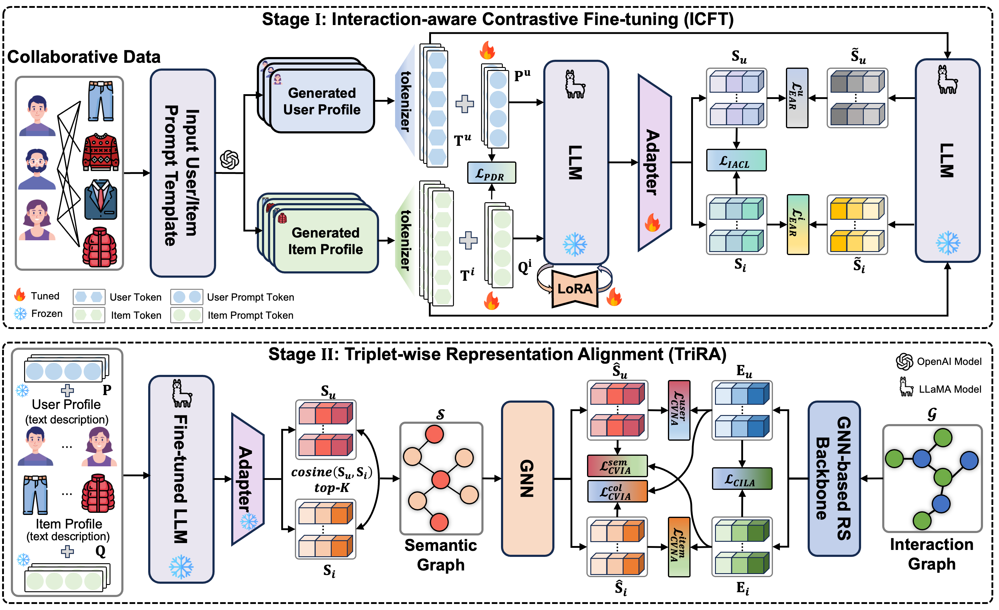

# ILRec: Interaction-Aware LLM-Driven Semantic Representation Generation and Reliable Alignment for Recommendation 🤝

<p align="left">
  <a href="figs/ILRec.png">
    
  </a>
  <br>
  <sub>Figure: ILRec framework.</sub>
</p>


---

## 1. Stage-1 (ICFT)

**Data**

We evaluate on **Book**, **Yelp**, **Steam**, and **Toy** [datasets](https://drive.google.com/file/d/16QOidCeeoJZxRoBsBNEP_TkvyQ2aCbIQ/view?usp=sharing).

**Env**

```
# Python 3.9–3.10 recommended
conda create -y -n ilrec-stage1 python=3.9
conda activate ilrec-stage1

pip install \
  transformers==4.30.2 \
  accelerate==1.7.0 \
  deepspeed \
  peft==0.5.0 \
  bitsandbytes==0.37.0 \
  datasets==3.6.0 \
  evaluate==0.4.4 \
  sentencepiece \
  jsonlines \
  pyyaml tqdm
```

**LLM Fine-tuning & Inference**

```
cd stage1
bash icft-tun.bash
bash icft-inf.bash
```

Outputs: interaction-aware semantic embeddings

```
ft_usr_emb.pkl
ft_itm_emb.pkl
```

## 2. Stage-2 (TriRA)

**Data**

```
stage2/data/{book|yelp|steam|toy}/
  ├─ trn_mat.pkl          # training
  ├─ val_mat.pkl          # validation
  ├─ tst_mat.pkl          # test
  ├─ semantic_graph_top<K>_mat.pkl          # semantic graph
  ├─ ft_usr_emb.pkl       # ← produced by Stage-1 (semantic embeddings) 
  └─ ft_itm_emb.pkl       # ← produced by Stage-1 (semantic embeddings)
  
```

**Quick start**

```
# Python 3.9 recommended
conda create -y -n ilrec-stage2 python=3.9
conda activate ilrec-stage2

# 1) Install the exact PyTorch stack you tested with (CUDA 11.6 wheels)
pip install torch==1.13.1+cu116 torchvision==0.14.1+cu116 torchaudio==0.13.1+cu116 \
  --extra-index-url https://download.pytorch.org/whl/cu116

# 2) Install PyG ops matching torch==1.13.1+cu116
pip install torch_scatter==2.1.2 torch_sparse==0.6.18 \
  -f https://data.pyg.org/whl/torch-1.13.1+cu116.html

# 3) Install the rest from the provided file in the repo
pip install -r stage2/requirements.txt
```

**Train**

```
cd stage2
python encoder/train_encoder.py \
  --model lightgcn_pro \
  --dataset book \
  --cuda 0
```
