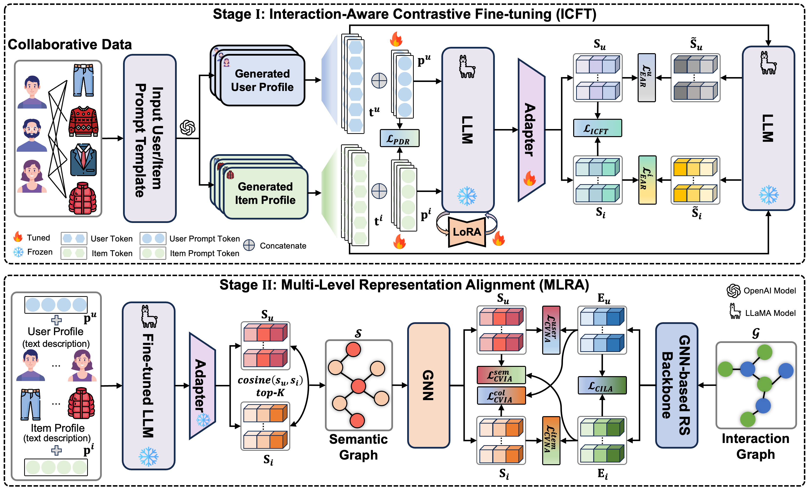

# ILRec: Interaction-Aware LLM-Driven Semantic Representation Generation and Alignment for Recommendation 🤝


> **Anonymous code release (double-blind).**  
> This repository implements **ILRec**, a two-stage framework that couples the semantic representation generation ability of Large Language Models (LLMs) with the higher-order relational modeling of Graph Neural Networks (GNNs) to improve recommendations.

- 👉 **ILRec.**  
  1) **Interaction‑Aware Contrastive Fine‑Tuning (ICFT):** we fine‑tune an LLM to generate interaction‑aware user/item semantic embeddings that pull together observed user-item pairs and push apart non‑interacted user-item pairs.  
  2) **Multi‑Level Representation Alignment (MLRA):** we align **semantic** and **collaborative** representations at both **node** and **interaction** levels with a set of contrastive objectives.
- 📚 **Outcome.** On four public datasets, ILRec consistently boosts GNN-based recommenders.

<p align="left">
  <a href="figs/framework.png">
    
  </a>
  <br>
  <sub>Figure: ILRec framework.</sub>
</p>
## Repository Layout ⚙️

```
.
├─ stage1/                                # Stage-1: LLM fine-tuning + semantic inference (ICFT)
│  ├─ configs/
│  │   └─ ds_config_stable.json           # DeepSpeed config
│  ├─ data/
│  │   ├─ book/ yelp/ steam/ toy/       # JSON/PKL for tuning & inference
│  ├─ figs/
│  ├─ llm/
│  │   ├─ data_processor/                 # tokenization & processors
│  │   ├─ peft/                           # LoRA utilities
│  │   ├─ arguments.py, llama.py, lora_cls.py, trainer_seq2seq.py
│  ├─ resources/
│  │   └─ llama-7b/                       # base LLM weights (place locally)
│  ├─ saved_models/                       # fine-tuned adapters + prompt params
│  ├─ trainers/, utils/
│  ├─ main_llm.py                         # training entry (ICFT)
│  ├─ batch_inference.py                  # batched embedding inference (user/item)
│  ├─ icft-tun.bash                       # script: fine-tune LLMs (ICFT)
│  └─ icft-inf.bash                       # script: infer semantics for all users/items
│
├─ stage2/                                # Stage-2: GNN training + multi-level alignment (MLRA)
│  ├─ data/                               # matrices + (fine-tuned) semantics
│  ├─ encoder/
│  │   ├─ config/modelconf/               # YAMLs (lightgcn[_pro], gccf[_pro], …)
│  │   ├─ data_utils/, models/, trainer/  # SSLRec-style pipeline
│  │   └─ train_encoder.py                # training entry (MLRA)
│
├─ LICENSE
└─ README.md                              # (this file)
```

---

## 1. Environment 📝

ILRec uses **two decoupled environments** (one per stage) to avoid library conflicts between LLM fine-tuning (Stage-1) and GNN recommendation training (Stage-2). Below are **tested, reproducible** setups distilled from the requirements you provided.

## **Stage-1 (LLM fine-tuning & inference)** 💡

**What’s in it:** PyTorch 2.x, Hugging Face stack (transformers, accelerate, datasets, evaluate), LoRA/PEFT, DeepSpeed, BitsAndBytes, etc.

**Use case:** run icft-tun.bash (LLM fine-tuning) and icft-inf.bash (semantic embedding inference).

**Quick start**
```
# Python 3.9–3.10 recommended
conda create -y -n ilrec-stage1 python=3.9
conda activate ilrec-stage1

# Install from the provided file in the repo
pip install -r stage1/requirements.txt
```

### **Minimal core (if you prefer manual install)** 
```
# PyTorch 2.x with CUDA (pick a wheel that matches your CUDA/driver)
# Example: pip install torch torchvision torchaudio --index-url https://download.pytorch.org/whl/cu121

pip install \
  transformers==4.30.2 \
  accelerate==1.7.0 \
  deepspeed \
  peft==0.5.0 \
  bitsandbytes==0.37.0 \
  datasets==3.6.0 \
  evaluate==0.4.4 \
  sentencepiece \
  jsonlines \
  pyyaml tqdm
```

## **Stage-2 (GNN recommendation training)** 💡

**What’s in it:** PyTorch **1.13.1+cu116** family with **PyG** (torch-geometric, torch_scatter, torch_sparse), SciPy/NumPy/Sklearn, etc.

**Use case:** train/evaluate backbone GNN recommenders and ILRec Stage-2 alignment.

**Quick start**
```
# Python 3.9 recommended
conda create -y -n ilrec-stage2 python=3.9
conda activate ilrec-stage2

# 1) Install the exact PyTorch stack you tested with (CUDA 11.6 wheels)
pip install torch==1.13.1+cu116 torchvision==0.14.1+cu116 torchaudio==0.13.1+cu116 \
  --extra-index-url https://download.pytorch.org/whl/cu116

# 2) Install PyG ops matching torch==1.13.1+cu116
pip install torch_scatter==2.1.2 torch_sparse==0.6.18 \
  -f https://data.pyg.org/whl/torch-1.13.1+cu116.html

# 3) Install the rest from the provided file in the repo
pip install -r stage2/requirements.txt
```

## 2. Data 📚

We evaluate on **Book**, **Yelp**, **Steam**, and **Toy** [datasets](https://drive.google.com/file/d/16QOidCeeoJZxRoBsBNEP_TkvyQ2aCbIQ/view?usp=sharing).

Stage‑2 expects sparse matrices and text resources:

```
stage2/data/{book|yelp|steam|toy}/
  ├─ trn_mat.pkl          # training interactions (scipy sparse)
  ├─ val_mat.pkl          # validation
  ├─ tst_mat.pkl          # test
  ├─ usr_prf.pkl          # (optional) user profile texts
  ├─ itm_prf.pkl          # (optional) item profile texts
  ├─ ft_usr_emb.pkl       # ← produced by Stage-1 (ILRec semantics)
  └─ ft_itm_emb.pkl       # ← produced by Stage-1 (ILRec semantics)
```

If you precompute a semantic interaction graph, place it as:```
stage2/data/<dataset>/semantic_graph_top<K>_mat.pkl

```
It will be auto‑loaded based on the YAML’s `semantic_topk`.
## 3. Stage‑1 — Interaction‑Aware Contrastive Fine‑Tuning (ICFT) 
Goal: adapt a base LLM (e.g., LLaMA‑7B) to output interaction‑aware user/item embeddings.
### 3.1 Prepare resources ✨
Download all the files and weights of LLaMA-7b from https://huggingface.co/meta-llama and put them to the folder /resources/llama-7b/
- 👉 Put base weights under:
```
  stage1/resources/llama-7b/
  ```
- 📚 Provide JSONL files under `stage1/data/<dataset>/`, e.g.:
  - 🏋️ `train_useritem_data.json`, `valid_useritem_data.json` (pairs for ICFT)
  - 🔮 `unique_users.json`, `unique_items.json` (for full inference)

### 3.2 Fine‑tune (LoRA + soft prompts + adapters) ✨
```代码语言
cd stage1
bash icft-tun.bash book \
  --lora_anchor_weight 0.005 \
  --prompt_div_weight 0.005 \
  --contrastive_anchor_weight 0.005 \
  --contrastive_temperature 1.0
  ```

Artifacts (lightweight only) are saved to:
```
stage1/saved_models/<EMB_DIM>/<run>/
  ├─ adapter_config.json
  ├─ adapter_model.bin
  ├─ prompt_params.bin
  ├─ model_adapter_params.bin
  └─ training_config.json
```

> The ICFT loss pulls together observed (user, item) pairs and separates negatives; optional **LoRA anchor** and **prompt diversity** regularizations are available (see bash flags). The DeepSpeed config is `stage1/configs/ds_config_stable.json`.

### 3.3 Inference (generate semantics for all users/items) 

```
cd stage1
bash icft-inf.bash
```

Outputs:```
stage1/saved_models/<run>/user_embeddings.{pkl,npy}
stage1/saved_models/<run>/item_embeddings.{pkl,npy}
```

Copy (or symlink) into **Stage‑2** using the expected filenames:
```bash
cp stage1/saved_models/<run>/user_embeddings.pkl stage2/data/book/ft_usr_emb.pkl
cp stage1/saved_models/<run>/item_embeddings.pkl stage2/data/book/ft_itm_emb.pkl
```

> If you see errors like “missing `adapter_config.json` / `prompt_params.bin`”, re‑check that `icft-tun.bash` finished successfully and that `icft-inf.bash` points to the same `OUTPUT_DIR`.

---

## 4. Stage‑2 — Multi‑Level Representation Alignment (MLRA) 

**Goal:** train a GNN recommender and align **semantic** (from Stage‑1) with **collaborative** representations at both **node** and **interaction** levels.

### 4.1 Choose a model ✨

"_pro" represents our proposed method ILRec, such as lightgcn_pro.

YAMLs live in `stage2/encoder/config/modelconf/`:

- 👉 **With MLRA**: `lightgcn_pro.yml`, `gccf_pro.yml`
- 👉 **Baselines**: `lightgcn.yml`, `gccf.yml`

Supported datasets: `book`, `yelp`, `steam`, `toy`.

### 4.2 Train ✨
```
cd stage2
python encoder/train_encoder.py \
  --model lightgcn_pro \
  --dataset book \
  --cuda 0
```

The trainer will:

- 👉 Read `{trn,val,tst}_mat.pkl`
- 👉 Load `ft_usr_emb.pkl` / `ft_itm_emb.pkl`
- 🕸️ (Optionally) load `semantic_graph_top<K>_mat.pkl`
- 👉 Optimize a mixture of: BPR, supervised contrastive terms, cross‑view (node + interaction) alignment losses, and regularization (see YAML).

#### Quick hyper‑parameter overrides ✨

You can override YAML keys at runtime:
```
python encoder/train_encoder.py --model lightgcn_pro --dataset book --cuda 0
```

---

## 5. Minimal Quickstart 🚀
```
# 0) Create env
conda create -y -n ilrec python=3.9 && conda activate ilrec
# (install deps as in Section 1)

# 1) Prepare data under stage2/data/<dataset>/ and stage1/data/<dataset>/

# 2) Stage-1: tune + infer
cd stage1
bash icft-tun.bash
bash icft-inf.bash
cp saved_models/<run>/user_embeddings.pkl ../stage2/data/book/ft_usr_emb.pkl
cp saved_models/<run>/item_embeddings.pkl ../stage2/data/book/ft_itm_emb.pkl

# 3) Stage-2: train recommender
cd ../stage2
python encoder/train_encoder.py --model lightgcn_pro --dataset book --cuda 0
```

---

## 6. What’s Inside (by stage) ✨

### Stage‑1 (ICFT) 

- 🧠 **Backbone:** LLaMA encoder (see `stage1/llm/llama.py`)
- 🏋️ **Trainables:** LoRA adapters (`stage1/llm/lora_cls.py`), soft prompts, lightweight projection heads
- 🧩 **Losses:** interaction‑aware contrastive; LoRA‑anchor regularization; prompt diversity regularization
- 🏋️ **Trainer:** custom `MedRecTrainer` / `trainer_seq2seq.py` with lightweight checkpointing (adapters + prompts only)
- 🏋️ **Scripts:** `icft-tun.bash` (training), `icft-inf.bash` (inference)

### Stage‑2 (MLRA) 

- 🕸️ **Backbones:** `lightgcn: lightgcn_pro.py`, `gccf: gccf_pro.py` (dual‑graph propagation with semantic graph)
- 👉 **Losses:** BPR loss, GNN-based backbone recommender losses, cross‑view (node-/interaction‑level) alignment losses
- 📚 **Configs:** YAMLs per model/dataset in `encoder/config/modelconf/`
- 🏋️ **Entrypoint:** `encoder/train_encoder.py`